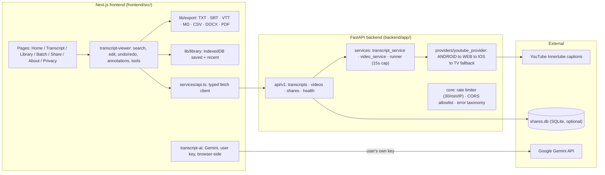

<div align="center">

# Transcora

**A free, no-account YouTube transcript generator — paste a link, get a searchable, editable, downloadable transcript in seconds.**

[](https://nextjs.org)
[](https://react.dev)
[](https://www.typescriptlang.org)
[](https://tailwindcss.com)
[](https://fastapi.tiangolo.com)
[](https://www.python.org)
[](https://vitest.dev)
[](https://playwright.dev)
[](#testing-and-verification)

[Features](#features) · [Tech stack](#tech-stack) · [Architecture](#architecture) · [Quick start](#quick-start) · [Usage](#usage-walkthrough) · [Security](#security-and-privacy) · [Testing](#testing-and-verification) · [Limitations](#limitations-and-known-issues) · [Roadmap](#roadmap) · [Docs](#project-documents)

</div>

---

## Introduction

**Transcora** turns available YouTube captions into text you can actually work with. Paste a YouTube URL, and within seconds you have a transcript you can search across, edit, annotate, export in seven formats, save to a browser-local library, or publish as a read-only share link — with no account, no payment, and no telemetry.

**The problem it solves.** Watching a video to find one sentence is slow; YouTube's own transcript panel cannot be searched across, edited, or exported cleanly; browser extensions quietly phone home; most "transcript generator" sites are ad walls behind sign-up forms. Transcora does the whole job **client-side where practical** (ADR-006/ADR-007): the backend's only job is fetching captions — search, editing, annotations, export, and the library all run in your browser.

**Who it is for.** Researchers, students, journalists, content repurposers, and anyone who wants a video's words as text — free and private, with nothing to sign up for.

**What it is not.** The transcript engine **extracts existing captions; it does not transcribe audio**, and it does not bypass private, age-gated, or paywalled content. It uses no proxies, no cookies, and no third-party APIs for YouTube access (ADR-004, [SECURITY.md](docs/SECURITY.md)).

**Maturity.** Version 1 and Version 2 tranches **T0–T6 are delivered**: all suites are green — **49 Pytest, 137 Vitest, 14/14 Playwright E2E with live YouTube**, plus clean `eslint`, `tsc --noEmit`, `next build` and `npm audit` (0 vulnerabilities) — and every feature was verified interactively in a real browser (see [Testing](#testing-and-verification)). **Production deployment (Phase 11) is the remaining step**; until then the app runs from source only.

> **Not affiliated with YouTube or Google.** Transcora extracts captions that already exist on public videos. Respect copyright law, YouTube's Terms of Service, and the rights of creators.

---

## Features

### Extraction

- **URL validation, both sides** — client-side parsing plus backend host allowlisting (`youtube.com`, `youtu.be`, shorts, live, embedded). The backend never fetches arbitrary user-supplied URLs (SECURITY.md §B).
- **Multi-client caption fetching** — the provider tries Innertube clients **ANDROID → WEB → IOS → TV** in order, so one refused client path never kills the request. No proxies, no cookies, no third-party APIs (ADR-004).
- **Language awareness** — a per-video language list, default/manual/generated track selection, and language switching that correctly resets edits and annotations (D1).
- **Honest error taxonomy** — no captions / video unavailable / upstream refused / timeout / rate-limited each map to a specific, human-readable card with a retry.

### Reading and search

- **Segment view** — timestamps that seek the embedded player (playback sync), active-segment highlighting, stats line (segments · words · characters · read time).
- **Search** — live match counter (`1/2`), highlight marks, prev/next with wrap in both directions (D2), and replace-all with a count toast.
- **Comfort controls** — reading mode (video hidden, single column, `R` shortcut), font size A−/A+, fullscreen (`F`), dark/light/system theme, `/` focuses search.

### Editing and annotations

- **Inline editing** — double-click any segment, `Ctrl+Enter` commits, `Esc` cancels; edits never blank a segment.
- **Undo/redo** — a 50-step history (`Ctrl+Z` / `Ctrl+Shift+Z`) covering edits, tools, and bulk transforms.
- **Productivity tools** — *Remove fillers* and *Clean up text*, each a single undo step with a "n segments updated" toast; find-and-replace with case-insensitive literal matching.
- **Annotations** — per-segment highlight tint, multiline inline notes, and bookmarks with prev/next toolbar navigation — all client-state, never uploaded (ADR-004).

### Export (7 formats + clipboard)

- **TXT, SRT, VTT, Markdown, CSV, DOCX, PDF** — timestamps preserved, your edits included; PDF embeds a Unicode font (ADR-013) so CJK and emoji survive.
- **Options dialog** — filename, include timestamps, metadata header, scope (*entire transcript* or *current search results*), and one-block-per-segment vs paragraph grouping.
- **Copy** with or without timestamps, plus select-all.

### Library (browser-local)

- **Save / open / remove** — persisted in IndexedDB (`transcora-library`), with a *Recent* list of the last 20 opened transcripts. Nothing is uploaded (ADR-004).
- **Import** — bring in `.txt`, `.srt`, `.vtt`, or `.md` files as transcripts (e.g. to compare against a video).

### Shareable links

- **Explicit consent gate** — nothing is shared until you tick the confirmation and press *Create link*; the dialog states exactly what happens.
- **30-day expiry** and a **one-time delete token** shown once at creation (ADR-011).
- **Read-only view** at `/s/[token]` — no editing controls, no account, ever (ADR-005).
- The server stores **only share payloads** — no database for anything else (ADR-011), with per-IP rate limiting on creation.

### Batch extraction

- Paste up to **20 URLs**, one per line; they are extracted sequentially with pacing, a failure never stops the rest, and each row reports *Done / failed* with an Open action.

### AI features (Phase 10, your key)

- **Gemini, browser-side, user-supplied key** — the key goes only to Google's API from your browser; it never touches Transcora's servers (ADR-009). Session-only by default, opt-in "remember".
- **Summaries, chapters, Ask-this-video chat, and speaker labels** — labels are applied as a single undoable edit step.
- **Compare** — diff the transcript against an imported file (added/removed lines colour-coded).

### Pages

| Page | What it does |
|---|---|
| **Home** (`/`) | URL form with validation, how-it-works, features anchor, FAQ |
| **Transcript** (`/transcript`) | The full workspace: player, search, tools, annotations, export, save, share |
| **Library** (`/library`) | Saved + recent transcripts, file import, open/remove |
| **Batch** (`/batch`) | Multi-URL extraction queue |
| **Share** (`/s/[token]`) | Read-only shared transcript view |
| **About / Privacy** (`/about`, `/privacy`) | Product story and plain-language privacy policy |

Sitemap, Open Graph metadata, and a web app manifest ship with the app (T6).

---

## Tech stack

| Technology | Version (verified) | Purpose | Role |
|---|---|---|---|
| [Next.js](https://nextjs.org) | ^16.4.4 (App Router) | Routing, SSR/CSR split, build | Build + runtime |
| [React](https://react.dev) | ^19.3.1 | UI layer | Runtime |
| [TypeScript](https://www.typescriptlang.org) | ^5.9 (strict) | Type safety end to end | Build |
| [Tailwind CSS](https://tailwindcss.com) | ^3.4.19 | Styling, design tokens, dark mode | Build |
| shadcn/ui-style components | local (`src/components/ui`) | Accessible primitives (button, dialog, menu, tooltip) | Runtime |
| [Vitest](https://vitest.dev) | ^5.0.5 | 137 frontend unit tests | Test |
| [Playwright](https://playwright.dev) | ^1.65 | 14 E2E tests against live servers + YouTube | Test |
| [jspdf](https://github.com/parallax/jspdf) / [docx](https://github.com/dolanmiu/docx) | ^4.2.1 / ^9.15.1 | PDF and DOCX export builders | Runtime |
| [FastAPI](https://fastapi.tiangolo.com) | >=0.115 | Backend API, validation, error taxonomy | Runtime |
| [Pydantic](https://docs.pydantic.dev) / pydantic-settings | >=2.8 / >=2.4 | Schema at every API boundary, env config | Runtime |
| [youtube-transcript-api](https://github.com/jdepoix/youtube-transcript-api) | >=1.2 | Caption extraction via Innertube clients | Runtime |
| [uvicorn](https://www.uvicorn.org) | >=0.30 | ASGI server | Runtime |
| httpx | >=0.27 | Backend HTTP client (metadata inspection) | Runtime |
| SQLite (via `DATABASE_URL`) | stdlib | Share-link storage only (ADR-011); optional | Runtime |
| Python / Node.js / npm | 3.13 / 22 / 11 | Tooling and backend | Build |

---

## Architecture



**Communication principle.** The frontend never sees the YouTube protocol; the backend never sees your edits. The two meet at one typed HTTP contract (`POST /api/v1/transcripts`, `POST /api/v1/videos/inspect`, `GET /api/v1/videos/{id}/languages`, `POST|GET|DELETE /api/v1/shares`, `GET /health`), documented in [ARCHITECTURE.md](docs/ARCHITECTURE.md). Exports, search, editing, annotations, and the library stay client-side (ADR-006/007).

**Repository structure**

```
frontend/
  src/app/                 7 routes (App Router pages)
  src/components/          transcript-viewer, export/share/AI/compare dialogs, ui primitives
  src/lib/                 export builders, IndexedDB library, importers, search, productivity, gemini
  src/services/api.ts      the typed backend contract
  e2e/                     14 Playwright tests (live YouTube)
  tests/                   137 Vitest unit tests
backend/
  app/api/v1/              transcripts, videos, shares routes
  app/services/            transcript_service, video_service, runner (threadpool + 15s cap)
  app/services/providers/  youtube_provider (multi-client fallback, error mapping)
  app/core/                config, security (rate limiter), exceptions (error taxonomy)
  tests/                   49 Pytest tests
docs/                      8 governing documents (see below)
```

**Data flow, end to end**

1. **URL in** — the frontend parses/validates; the backend re-validates the host and extracts a video ID (it never proxies arbitrary URLs).
2. **Inspection** — metadata (title, channel, thumbnail) via httpx; caption-language list via the provider.
3. **Extraction** — `youtube-transcript-api` tries each Innertube client until one answers; all work runs in a threadpool with a 15-second response cap.
4. **Transcript out** — segments are cleaned and returned; from here everything (search, edit, export, library, share) happens in your browser.
5. **Sharing (opt-in)** — only after explicit consent, the transcript payload is stored in SQLite with a hashed token, 30-day expiry, and a one-time delete token.

---

## Quick start

```powershell
# Backend (Python 3.13) — http://localhost:8000
cd backend
python -m venv .venv
.venv\Scripts\pip install -r requirements.txt
$env:DATABASE_URL='sqlite:///./shares.db'    # optional; sharing is disabled without it
.venv\Scripts\python -m uvicorn app.main:app --host 127.0.0.1 --port 8000

# Frontend (Node 22) — http://localhost:3000
cd frontend
npm install
npm run dev
```

Open http://localhost:3000 and paste a YouTube URL.

**Environment variables**

| Where | Variable | Default | Purpose |
|---|---|---|---|
| backend | `DATABASE_URL` | *(empty)* | `sqlite:///…` enables share links; empty = sharing disabled (ADR-011) |
| backend | `RATE_LIMIT_REQUESTS` | `30` | Requests per 60 s per IP |
| backend | `REQUEST_TIMEOUT_SECONDS` | `15` | Cap on provider work per request |
| frontend | `NEXT_PUBLIC_API_BASE_URL` | `http://localhost:8000` | Backend origin |
| frontend | `NEXT_PUBLIC_SITE_URL` | — | Deployed origin for sitemap/OG absolute URLs |

---

## Usage walkthrough

1. **Start both servers** (above) and open http://localhost:3000.
2. **Paste a YouTube link** on the Home page and press *Generate Transcript*.
3. **Read** — segments with timestamps; click one to seek the video; `A+`/`A−` resize text; *Reading mode* hides the video for a clean column.
4. **Search** — type in the search box (`/` to focus); the counter shows `1/n`; *Replace all* rewrites matches in one undoable step.
5. **Edit** — double-click a segment, change the text, `Ctrl+Enter` to commit; `Ctrl+Z`/`Ctrl+Shift+Z` undo/redo; *Remove fillers* and *Clean up text* tidy the whole transcript.
6. **Annotate** — highlight tint, add a multiline note, bookmark a segment and jump between bookmarks with ‹★/★›.
7. **Export** — *Export* → pick one of 7 formats, set filename/timestamps/scope → download; or *Copy* with/without timestamps.
8. **Save** — *★ Save* stores it in your browser's library (nothing uploaded); reopen any time from **Library**.
9. **Share** — *Share* → read the disclosure → tick the consent box → *Create link*; copy the URL and the one-time delete token (shown once). Links expire after 30 days.
10. **Batch** — paste up to 20 URLs on the **Batch** page; watch per-row progress; failures don't stop the run.
11. **AI (optional)** — *✨ AI* → paste your own free [Gemini API key](https://aistudio.google.com) → summaries, chapters, chat, speaker labels. The key stays in your browser.
12. **Import** — *Library → Import file* loads a TXT/SRT/VTT/MD file as a transcript (handy for *Compare*).

> The language dropdown lists the caption tracks YouTube has for that video; videos with a single track show only *Default*.

---

## Security and privacy

Transcora is a **web app with no accounts, ever** (ADR-005). The server stores share links and nothing else (ADR-011); your edits, library, and annotations never leave the browser (ADR-004).

**Verified safeguards**

- **No arbitrary URL fetching** — the backend only accepts YouTube watch/shorts/live URLs, extracts a video ID, and talks to YouTube's caption endpoints. No open proxy, SSRF surface, or generic fetch endpoint.
- **No proxies, cookies, or third-party APIs for YouTube access** (ADR-004, SECURITY.md) — only `youtube-transcript-api`'s Innertube clients.
- **No authentication, no sessions, no telemetry** — nothing to breach, nothing to sell (ADR-005).
- **Rate limiting** — 30 requests/min/IP (CORS preflights exempt), `Retry-After` on 429; share creation has its own 10/hour, 50/day limits.
- **Body-size caps** — 16 KiB default, 1 MiB for share payloads (a share carries a transcript).
- **Explicit share consent** — nothing is stored server-side until the user ticks a disclosure; links expire in 30 days; deletion needs a one-time token; tokens are stored hashed.
- **Error responses leak nothing** — internals stay out of the body (SECURITY.md §D); CORS is an explicit allowlist with no wildcard and no credentials.
- **AI keys are yours** — sent only from your browser to Google's API, never to Transcora, never logged (ADR-009).
- **Dependency hygiene** — `npm audit` reports 0 vulnerabilities; dependencies are deliberately few.

See [docs/SECURITY.md](docs/SECURITY.md) for the full threat model.

---

## Testing and verification

Results from the last full run — **executed 2026-11-08, Windows x64** (details in [docs/TESTING.md](docs/TESTING.md) §W1):

| Check | Result | Coverage |
|---|---|---|
| `python -m pytest` (backend) | **49/49 passed** | Routes, services, rate limiting, share lifecycle, provider error mapping |
| `npm test` (Vitest) | **137/137 passed** | Export builders, search/productivity logic, importers, diff, Gemini client, API contract |
| `npx playwright test` (E2E, live YouTube) | **14/14 passed** (1.3 min, 4 workers) | Extraction, export, editing workflow, D1 language switch, library, responsive, themes |
| `npm run lint` (eslint) | clean | — |
| `npx tsc --noEmit` (strict) | zero errors | — |
| `npm run build` (next build) | green | Production bundle |
| `npm audit` | 0 vulnerabilities | — |
| Interactive browser pass | all flows verified with a real video URL | extract → search → edit/undo → annotations → TXT export (content verified) → library → share link + `/s/…` view → batch → import → theme/AI/compare dialogs → **zero console errors** |

**Live vs offline.** The default suites (Pytest, Vitest) are deterministic and offline — they cover parsers, builders, validators, state machines, and the API contract with mocked providers. The Playwright suite runs against the real dev servers and **live YouTube**: it is quota-sensitive (an IP-level block has occurred and cleared; the multi-client fallback mitigates refused client paths), so treat its failures as environment signals first and re-run before suspecting code.

**Not yet covered:** caption-less video and backend-down error paths in E2E, and production-build E2E — both planned with deployment (§S).

---

## Limitations and known-issues

1. **Not deployed** — there is no production URL yet; Phase 11 (Vercel + a Python host) is pending. All runs are local (see [docs/DEPLOY.md](docs/DEPLOY.md)).
2. **Live E2E depends on YouTube quota** — bursts of extracts from one IP can be refused; the ANDROID-first fallback and a raised test-only rate limit (`RATE_LIMIT_REQUESTS=300`) mitigate this, but external blocks can still fail the live tests.
3. **No audio transcription** — if a video has no captions, there is nothing to extract; that is by design (the product definition says so).
4. **Playlist browsing UI is deliberately unbuilt** — ADR-012 holds it pending the owner's platform-ToS review. Batch extraction by URL list exists today; playlist pickers do not.
5. **Language switching is limited to existing caption tracks** — no AI translation of transcripts (V2 scope excludes it).
6. **Sharing requires `DATABASE_URL`** — without it, the Share button correctly reports *Sharing is currently unavailable*.
7. **Rate limiter is in-memory** — per-IP counters reset when the backend restarts; it is a courtesy limit, not a WAF.
8. **AI features require your own Gemini key** and inherit Google's free-tier rate limits; without a key the dialog explains how to get one.
9. **The D1 E2E test skips** on videos that list fewer than two caption languages (its guard waits up to 15 s for the language list first).

---

## Roadmap

### Next — Phase 11: deployment

- [ ] Deploy frontend to Vercel, backend to a Python-compatible host, following the [DEPLOY.md](docs/DEPLOY.md) runbook
- [ ] Production-build E2E against the deployed origin (TESTING §S)
- [ ] E2E coverage for caption-less video and backend-down error paths

### Held for owner decision

- [ ] Playlist UI — blocked on the owner's platform-ToS review (ADR-012)

Nothing beyond these is scheduled: no speculative features are built ahead of the roadmap in [docs/PROJECT.md](docs/PROJECT.md).

---

## Troubleshooting

| Symptom | Likely cause | What to do |
|---|---|---|
| "Could not reach the server. Make sure the backend is running." | Backend not running on `:8000` | Start it (Quick start); check `http://127.0.0.1:8000/health` returns `{"status":"ok"}` |
| "Sharing is currently unavailable." | `DATABASE_URL` not set | Restart the backend with `$env:DATABASE_URL='sqlite:///./shares.db'` |
| "YouTube is temporarily refusing requests." | Upstream refused this IP/client | Wait and retry — the backend already falls back across ANDROID/WEB/IOS/TV clients; persistent failure means YouTube-side quota from your network |
| "This video has no captions." | The video genuinely has none | Try a different video; Transcora extracts existing captions only |
| Language list shows only *Default* | Single caption track | Nothing to switch to; the E2E D1 test skips for the same reason |
| E2E live tests fail but manual use works | YouTube quota or a mid-run rate limit | Check `docs/TESTING.md` §W1 for the observed failure signatures; re-run after a pause |
| Share link shows expired/removed | 30-day TTL passed or delete token used | Create a new link |

---

## Project documents

| File | Responsibility |
|---|---|
| [AGENTS.md](AGENTS.md) | How AI coding agents work on this repo |
| [docs/PROJECT.md](docs/PROJECT.md) | Product requirements and the 11-phase roadmap |
| [docs/ARCHITECTURE.md](docs/ARCHITECTURE.md) | System structure and API contract |
| [docs/DESIGN_SYSTEM.md](docs/DESIGN_SYSTEM.md) | UI tokens, components, accessibility |
| [docs/TASKS.md](docs/TASKS.md) | Progress tracking |
| [docs/TESTING.md](docs/TESTING.md) | Test strategy, commands, and executed evidence |
| [docs/DECISIONS.md](docs/DECISIONS.md) | Architecture decision records (ADR-001…013) |
| [docs/SECURITY.md](docs/SECURITY.md) | Security requirements and threat model |
| [docs/DEPLOY.md](docs/DEPLOY.md) | Production deployment runbook (Phase 11) |

---

## License

No license file has been published yet — rights are reserved by the author. Open an issue if you want to use Transcora under different terms.

---

## Acknowledgments

Built on the work of many open-source projects — no affiliation or endorsement is implied:

- [youtube-transcript-api](https://github.com/jdepoix/youtube-transcript-api) — the caption-extraction library the backend is built on
- [FastAPI](https://fastapi.tiangolo.com), [Pydantic](https://docs.pydantic.dev) — the backend platform
- [Next.js](https://nextjs.org), [React](https://react.dev), [Tailwind CSS](https://tailwindcss.com), [TypeScript](https://www.typescriptlang.org) — the frontend toolchain
- [shadcn/ui](https://ui.shadcn.com) — the component patterns behind `src/components/ui`
- [Vitest](https://vitest.dev), [Playwright](https://playwright.dev) — the test toolchains
- [Google Gemini](https://ai.google.dev/) — the optional, user-keyed AI features (ADR-008/009)
